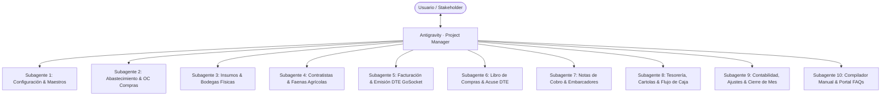
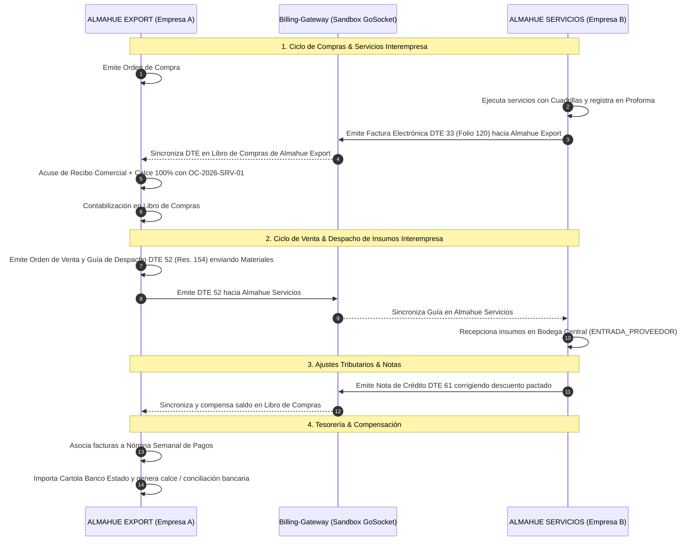
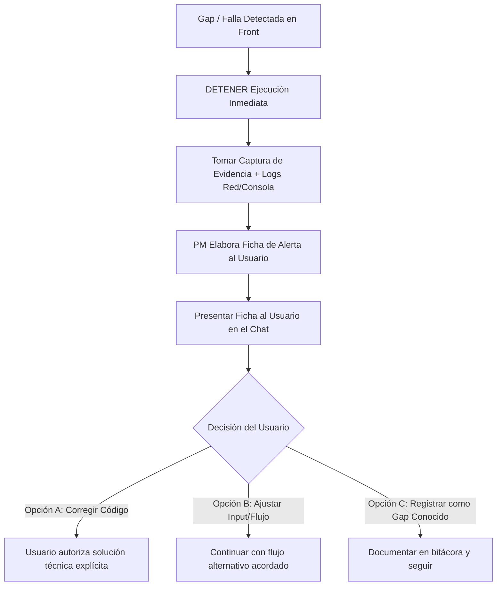

# Plan de Ejecución: Simulación de Mes Contable Completo Interempresa (Almahue Export ↔ Almahue Servicios)

## 1. Visión General del Proyecto

### 1.1. Propósito
Ejecutar una prueba integral de **un mes contable operativo completo (Octubre 2026)** en el ERP Almahue simulando un entorno de **dos empresas jurídicamente independientes pero relacionadas comercialmente**:
1. **Empresa A: ALMAHUE EXPORT SPA** (`ALM` / RUT `77.032.639-7` / `EMP-1` / `EMP-EXPORT`) — Exportadora frutícola.
2. **Empresa B: SOCIEDAD AGRICOLA Y SERVICIOS ALMAHUE LTDA** (`AGR` / RUT `76.111.222-3` / `EMP-2` / `EMP-SERVICES`) — Prestadora de servicios agrícolas, empaque, frío y logística.

La prueba ejecutará transacciones cruzadas bilaterales (emisión y recepción de documentos tributarios oficiales vía `billing-gateway` sandbox GoSocket), cubriendo **todos los módulos, flujos, tipos de documentos, estados, contabilizaciones y cierres** sin dejar código sin probar.

> [!IMPORTANT]
> **Regla de Oro de Código Intacto**: Bajo la instrucción expresa del usuario, **no se modificará ninguna línea de código del aplicativo**. Todo gap, descuadre o comportamiento anómalo detectado será **alertado de inmediato al usuario**, catalogado formalmente con evidencia gráfica y se solicitará la decisión de resolución antes de continuar.

> [!NOTE]
> **Canal Exclusivo de Entrada**: Todos los inputs se realizarán **estrictamente desde el Frontend**, interactuando con botones, formularios, selectores, modales y validaciones reales vía navegador Chrome (Playwright viewport $1536 \times 960$). Cada acción generará capturas de alta definición para compilar automáticamente el **Manual de Usuario Oficial** y el portal web interactivo de **Preguntas Frecuentes (FAQs)**.

---

## 2. Estructura Organizacional: PM y Equipo de Subagentes

El modelo operará como un equipo de trabajo profesional donde el **PM (Project Manager)** coordina, asigna tareas, fiscaliza la calidad de capturas y reporta al usuario, mientras los **subagentes especializados** ejecutan cada fase de forma secuencial y coordinada:



### Roles y Responsabilidades
1. **PM (Project Manager)**:
   - Supervisa el cronograma de Octubre 2026 día a día contable.
   - Valida la consistencia de cada entregable antes de dar paso a la siguiente fase.
   - Aplica el **Protocolo de Detección de Gaps** y gestiona las decisiones con el usuario.
   - Presenta el consolidado final y los accesos al Manual de Usuario y Portal FAQ.
2. **Subagente 1 (Configuración & Parametrización)**: Valida y audita maestros de ambas empresas (Cuentas, Centros de Costo, Monedas, Bancos, Proveedores, Clientes, Factores de Honorarios).
3. **Subagente 2 (Compras & Aprobaciones)**: Crea OCs en cascada (`Cuenta -> CC -> Elemento`), gestiona solicitudes de dimensiones, prueba el motor de escalas de aprobación de Compras y genera PDFs oficiales de compra.
4. **Subagente 3 (Insumos & Inventario)**: Ejecuta recepciones con guía física (`ENTRADA_PROVEEDOR`), verifica la prohibición estricta de saldo negativo y traslados entre bodegas.
5. **Subagente 4 (Contratistas)**: Ingreso de cuadrillas diarias, cálculo de tarifas, emisión de proformas, protocolo de reversa y traspaso de provisión de cierre mensual.
6. **Subagente 5 (Ventas & Emisión DTE GoSocket)**: Crea OVs (`CONFIRMADA`), valida regla D16 (precio de compra no vulnerado) y emite DTEs reales (33 Factura, 34 Exenta, 52 Guía Res. 154, 61 NC, 56 ND) hacia la otra empresa mediante `billing-gateway` sandbox.
7. **Subagente 6 (Libro de Compras & Trazabilidad)**: Sincroniza GoSocket en la empresa receptora, genera acuse de recibo y aceptación comercial (8 días), calza con OC/recepciones (barra de cobertura), registra Boletas de Honorarios (1001, 1002 notarial y 1003 con retención).
8. **Subagente 7 (Notas de Cobro & Bloqueo Tesorería)**: Carga masiva de planillas Excel/CSV de embarcadores (OPB), gastos directos, compensación de facturas, bloqueo de pago en Tesorería y anulación autorizada con PIN de 4 dígitos.
9. **Subagente 8 (Tesorería & Conciliación)**: Importación de cartolas bancarias (asiento de cartola `CARTOLA:{id}`), calce con facturas/notas, nómina semanal de compromisos, aging bimoneda (Neto USD + IVA al día 20 F29) y flujo de caja regla F0.
10. **Subagente 9 (Contabilidad, Ajustes & Cierre)**: Centralización de libros auxiliares, asientos de diario (ingreso/egreso/traspaso), revaluación cambiaria TC Banco Central, depreciación, reversas contables auditables y cierre mensual formal del periodo contable.
11. **Subagente 10 (Compilación de Manual de Usuario & Portal FAQs)**: Estructura todas las capturas Playwright y evidencias en documentos navegables finales.

---

## 3. Matriz de Entidades y Transacciones Cruzadas Interempresa



---

## 4. Cronograma Detallado del Mes Contable (Octubre 2026)

El mes contable de simulación transcurrirá en 7 fases operativas ordenadas cronológicamente:

### Semana 1 (Días 01 al 07 de Octubre): Parametrización & Arranque Operativo
- **Día 1**: Apertura de periodo contable `2026-10` en ambas empresas. Asiento de apertura de saldos contables iniciales.
- **Día 2**: Verificación visual de Maestros: Plan de cuentas alineado N:N con dimensiones, bancos multi-cuenta (CLP y USD), bodegas (`PACK-02`, `BOD-03`), insumos agrícolas y de embalaje.
- **Día 3**: Emisión en Empresa A de Orden de Compra Nº 1 (Insumos embalaje) y Nº 2 (Servicios de packing a Empresa B) mediante Wizard de 3 pasos:
  - Paso 1: Datos proveedor y validación de ficha.
  - Paso 2: Imputación estricta Cuenta -> Centro de Costo -> Elemento de Gasto. Disparo y captura del modal *Solicitud al Administrador de Dimensiones Faltantes*.
  - Paso 3: Referencias comerciales y cálculo de cadena de aprobación Compras.
- **Día 4**: Aprobación de OC mediante cadena multinivel con usuario de jefatura Compras (`adminConceptoModulos`).
- **Día 5**: Recepción física de insumos en bodega con respaldo de Guía de Despacho física. Validación de prohibición estricta de stock negativo.

### Semana 2 (Días 08 al 15 de Octubre): Contratistas, Faenas & Facturación Cruzada
- **Día 8**: Módulo Contratistas: ingreso diario de faenas por cuadrilla, selección de Actividad -> Labor invertida y cálculo de tarifas por contratista.
- **Día 10**: Generación de Proformas quincenales (`BORRADOR` -> `DEFINITIVA`).
- **Día 12**: Emisión cruzada desde Empresa B (Almahue Servicios):
  - Emisión de Factura Electrónica DTE 33 por servicios de cosecha y empaque dirigida al RUT de Empresa A (`77.032.639-7`) a través de `billing-gateway`.
  - Emisión de Factura Exenta DTE 34 por asesorías técnicas y gastos directos.
- **Día 13**: Sincronización en Empresa A desde GoSocket:
  - Recepción de las facturas en el Libro de Compras.
  - Generación de Acuse de Recibo y Aceptación Comercial (plazo 8 días).
  - Asociación de la factura a la OC previa, visualizando la **barra de porcentaje de cobertura**.
  - Visualización del PDF oficial GoSocket con timbre TED y membrete tributario.

### Semana 3 (Días 16 al 22 de Octubre): Ventas, Guías 154, Honorarios & Notas de Cobro
- **Día 16**: Ventas en Empresa A:
  - Creación de Orden de Venta validando stock en bodega específica y verificando la regla de precio de compra D16 (prohibición de vender bajo el costo del maestro).
  - Emisión de Guía de Despacho Electrónica DTE 52 bajo Resolución SII 154 con destino a frigorífico de Empresa B.
- **Día 18**: Registro de Boletas de Honorarios en Libro de Compras:
  - Boleta Tipo 1001 (Electrónica con retención 13.75%).
  - Boleta Tipo 1002 (Exenta notarial con validación de alerta legal estricta).
  - Boleta Tipo 1003 (Servicios prestados con retención).
  - Verificación de cálculo automático de fecha de vencimiento a +30 días.
- **Día 20**: Notas de Cobro:
  - Registro de Nota de Cobro de Gasto Directo (Asoex / Exentos).
  - Registro de Nota de Cobro de Embarcadores (OPB) con **carga masiva de planilla Excel (.xlsx)** y prevalidación en vivo.
  - Compensación y calce de facturas del Libro de Compras, verificando que queden con el badge de **bloqueo de pago directo en Tesorería**.
  - Simulación de error operativo y ejecución del **Flujo de Anulación Autorizada con PIN de 4 dígitos**, generando el comprobante de reverso contable correspondiente.

### Semana 4 (Días 23 al 28 de Octubre): Tesorería, Conciliación & Flujo de Caja
- **Día 23**: Importación de Cartola Bancaria Excel/CSV en formato oficial de banco chileno.
  - Verificación de la creación automática del asiento contable de cartola (`CARTOLA:{id}`).
  - Proceso de conciliación bancaria y calce de movimientos.
- **Día 25**: Nóminas Semanales y Aging:
  - Generación de Nómina Semanal de Pagos por banco y vencimiento.
  - Asignación de compromisos bimoneda: desglose de la deuda comercial en USD y el IVA impositivo en CLP al día 20 del mes siguiente (F29).
  - Pagos directos: `PAGO_TOTAL`, `ANTICIPO` y `ANTICIPO_PRODUCTOR`.
- **Día 28**: Módulo Flujo de Caja:
  - Visualización de la proyección de saldos por banco y moneda.
  - Comprobación de la Regla F0: los compromisos futuros y anticipos se proyectan sin generar asientos contables artificiales que alteren el balance.

### Fin de Mes (Días 29 al 31 de Octubre): Contabilidad, Ajustes & Cierre Mensual
- **Día 29**: Cierre mensual de Contratistas:
  - Pantalla de Cierre Mensual con segregación de Bloques Verde (proformas del periodo) y Gris (fuera de periodo).
  - Generación del asiento de cierre: gasto agrupado por Centro de Costo y provisión de pasivo con auxiliar RUT.
- **Día 30**: Asientos de Ajuste Contable:
  - Revaluación de activos y pasivos en moneda extranjera según el Tipo de Cambio oficial del Banco Central.
  - Centralización definitiva de los libros auxiliares (Ventas, Compras, Honorarios, Tesorería).
  - Prueba de Protocolo de Reversas de Comprobantes con justificación de 10+ caracteres y generación de asiento invertido.
- **Día 31**: Cierre Contable del Periodo:
  - Generación del **Balance de 8 Columnas** verificando sumas iguales exactas ($\text{Débitos} = \text{Créditos}$).
  - Generación del **Estado de Resultados** del mes.
  - Ejecución del **Cierre Definitivo del Periodo `2026-10`**, validando que la pantalla bloquee cualquier modificación posterior.

---

## 5. Protocolo de Capturas y Generación de Entregables

### 5.1. Estándar de Captura Playwright
- **Motor**: Google Chrome nativo (`C:/Program Files/Google/Chrome/Application/chrome.exe`) con visor PDFium integrado para documentos tributarios.
- **Resolución**: Fija en **$1536 \times 960$ sin recorte**, garantizando que se aprecie la barra de navegación, menús laterales, tarjetas KPI y formularios completos.
- **Nomenclatura**: `mes-contable-dia{DD}-{modulo}-{accion}.png`.
- **Almacenamiento**: `docs/manual/capturas/`.

### 5.2. Estructura de Entregables Finales
1. **Manual de Usuario ERP Almahue (`docs/manual/MANUAL-USUARIO-ERP-ALMAHUE.md` y `.html`)**:
   - Organizado por módulos: Maestros, Compras, Insumos, Contratistas, Ventas, Tesorería y Contabilidad.
   - Cada procedimiento detallado paso a paso con su captura en alta resolución, recuadros explicativos y notas operativas.
2. **Portal Web de Preguntas Frecuentes (FAQs) (`docs/manual/faqs.html`)**:
   - Interfaz web moderna con buscador por palabras clave, acordeones temáticos y enlaces a las capturas del sistema.
   - Casos de uso complejos resueltos: *"¿Cómo calzo una nota de embarcador con facturas?", "¿Por qué no puedo vender bajo el precio de compra?", "¿Cómo se refleja el IVA al día 20 en facturas USD?"*, etc.
3. **Informe Ejecutivo del Mes Contable (`docs/manual/INFORME-CIERRE-OCTUBRE-2026.md`)**:
   - Balance general de 8 columnas cuadrado.
   - Reporte de cuadre fiscal F29.
   - Historial de todas las emisiones GoSocket con sus números de folio oficiales y timbres TED.

---

## 6. Protocolo de Detección de Gaps (NO Modificar Código)

Si durante la ejecución en el Frontend un subagente detecta cualquier inconsistencia, error de validación, excepción HTTP 4xx/5xx, descuadre aritmético o comportamiento inesperado, se aplicará el siguiente procedimiento obligatorio:



### Ficha Estándar de Alerta de Gap
```markdown
### 🚨 ALERTA DE GAP DETECTADO — [Módulo] [Día Contable]
- **Pantalla / URL**: `http://localhost:5174/...`
- **Acción Intentada**: Descripción exacta de los datos ingresados y botón presionado.
- **Resultado Obtenido**: Mensaje de error, toast o bloqueo observado en pantalla.
- **Resultado Esperado**: Comportamiento funcional o contable esperado.
- **Evidencia**: Captura guardada en `docs/manual/capturas/gap-...png` y log de red.
- **Propuesta de Resolución**: Alternativas técnicas o de proceso para que el usuario elija.
```

---

## 7. Plan de Verificación y Criterios de Aceptación

### 7.1. Criterios de Éxito de la Simulación
- [ ] **100% Cobertura de Módulos**: Todos los menús y pantallas operados exitosamente desde la UI.
- [ ] **Bilateralidad GoSocket**: DTEs emitidos desde Empresa B recibidos y aceptados exitosamente en Empresa A mediante `billing-gateway` sandbox con timbre TED legal.
- [ ] **Integridad Aritmética y Contable**: Balance de Comprobación y Saldos con sumas iguales exactas en Débito y Crédito.
- [ ] **Trazabilidad Completa**: Documentos comerciales vinculados con trazabilidad de OC -> Recepción -> Factura -> Pago -> Conciliación.
- [ ] **Material Gráfico Completo**: Mínimo 50 capturas de pantalla reales en $1536 \times 960$ sin duplicados ni pantallas en blanco.
- [ ] **Código Intacto**: Cero modificaciones de código no autorizadas durante la ejecución.

---

## 8. Preguntas de Alineación para el Usuario

Antes de activar a los subagentes e iniciar la Fase 0, solicito confirmar los siguientes puntos operativos:

1. **Monedas de Operación**: ¿Deseas que simulemos transacciones exclusivamente en **CLP** o incorporamos compras/ventas internacionales en **USD** (como la importación de insumos o exportación de fruta) para poner a prueba el convertidor de tipo de cambio del Banco Central y el aging bimoneda?
2. **Empresas a Utilizar**: ¿Confirmas el uso de **`Almahue Export SpA`** (`EMP-1` / `EMP-EXPORT`) y **`Almahue Logística/Servicios`** (`EMP-2` / `EMP-SERVICES`) como las dos entidades del ecosistema?
3. **Inicio de Ejecución**: Tras tu aprobación de este plan, daré inicio de inmediato a la **Fase 0 (Auditoría de Maestros y Parametrización)** como PM coordinando al primer subagente.
