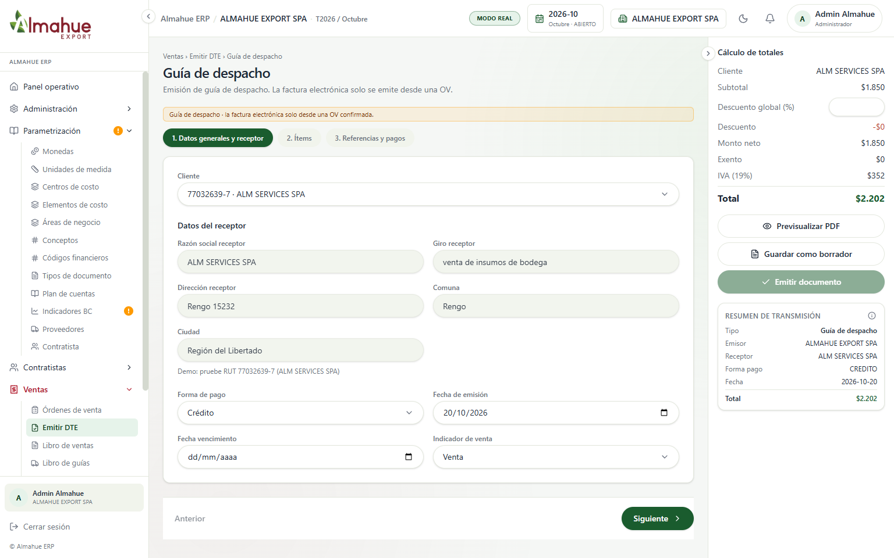
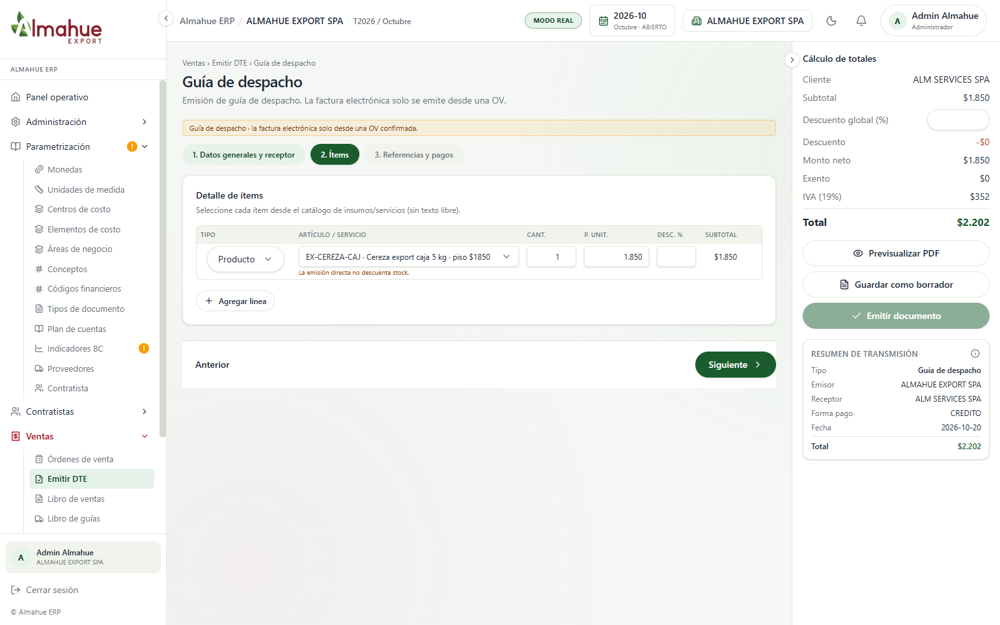
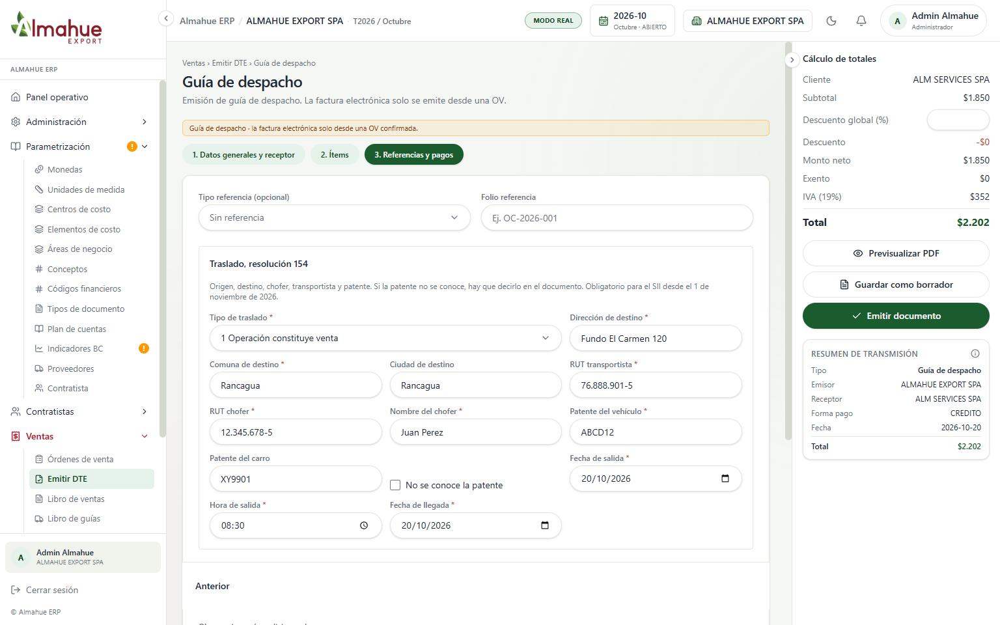
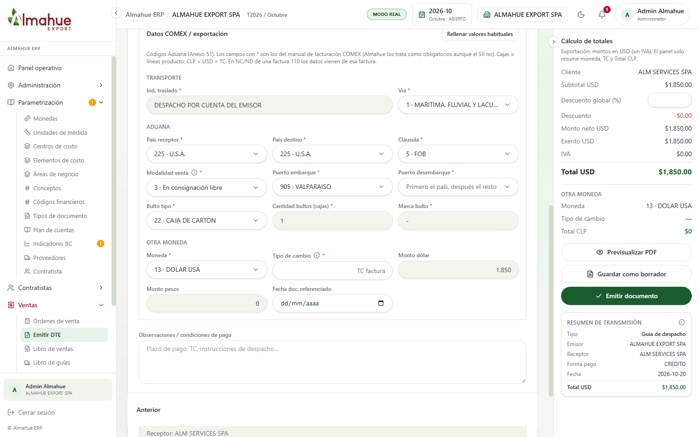

# Plan de pruebas de emisión para GoSocket

27 documentos en el QA de GoSocket: tres o cuatro de cada tipo que emite el ERP. Cada fila cambia algo que tiene que verse en el XML y en el PDF. No es el mismo documento repetido.

Cuando estén cargados, se avisa. La revisión es rechazo o reparo, y si el PDF muestra los datos de esta planilla. El folio lo asigna GoSocket. La columna Folio queda vacía hasta la emisión.

Las capturas son de la pantalla de emisión, con datos de ejemplo. No se guardó ni se emitió el documento para sacarlas.

## Qué se espera en todos los casos

- El documento queda aceptado, o pendiente con identificador de GoSocket utilizable. No alcanza un HTTP 200 si el identificador viene en cero.
- No hay rechazo de esquema (largo de campos, IVA, referencia sin fecha, domicilio vacío).
- Se puede bajar el PDF y el XML desde el ERP.
- El PDF muestra los datos de la columna Esperado. Lo que no está en esa columna no se exige en esta pasada.
- Folio oficial: el que asigne el CAF. El número interno del ERP no es el folio SII.

## Datos que se repiten

| Dato | Valor de los ejemplos |
|---|---|
| Emisor | ALMAHUE EXPORT SPA |
| Receptor nacional | ALM SERVICES SPA, RUT 77.032.639-7 |
| Giro receptor | venta de insumos de bodega |
| Dirección receptor | Rengo 15232 |
| Comuna receptor | Rengo |
| Ciudad receptor | Región del Libertador |
| Fecha de emisión | 20/10/2026 |
| Ítem base | EX-CEREZA-CAJ, Cereza export caja 5 kg, precio unitario 1.850 |
| IVA | 19% en afecta. Cero en exenta y en exportación |

Cabecera del ejemplo. Emisor ALMAHUE EXPORT SPA, receptor ALM SERVICES SPA, fecha 20/10/2026. En la foto la forma de pago es Crédito. El caso 33-1 usa Contado. El resto de los casos nacionales usa Crédito, salvo que la fila diga otra cosa.

Ítem base: 1 caja a 1.850. Neto 1.850, IVA 352, total 2.202. Los casos que dicen "ítem base" usan esta línea.

## Factura afecta (DTE 33)

| Id | Enviado | Esperado | Folio |
|---|---|---|---|
| 33-1 | Contado. Ítem base. Sin referencia. Neto 1.850, IVA 352, total 2.202 | Tipo 33. IVA 19%. Receptor y totales iguales a lo enviado. Sin bloque de referencia | |
| 33-2 | Crédito. Línea 1: 10 cajas a 1.850 con 10% de descuento (16.650). Línea 2: 1 pallet código 0001 a 10.000. Neto 26.650, IVA 5.064, total 31.714 | Dos ítems. El descuento se ve en la línea y en el total. IVA 19% sobre 26.650 | |
| 33-3 | Igual que 33-1, más referencia tipo 801, folio OC-2026-001 | El PDF muestra la orden de compra referenciada | |
| 33-4 | Ítem base más una línea de flete, cantidad 1, precio 1.500. Neto 3.350, IVA 637, total 3.987 | El flete es un ítem ("Flete"), no un recargo escondido del producto | |

## Factura exenta (DTE 34)

Indicador de venta Exento. IVA 0. El neto va como monto exento.

| Id | Enviado | Esperado | Folio |
|---|---|---|---|
| 34-1 | Ítem base. Neto 1.850, IVA 0, total 1.850 | Tipo 34. Sin IVA. Exento 1.850 | |
| 34-2 | Línea cereza 1.850 y línea pallet 10.000. Neto 11.850, IVA 0, total 11.850 | Dos ítems, total exento | |
| 34-3 | Igual que 34-1, referencia tipo 801, folio OC-2026-001 | Referencia visible, sin IVA | |

## Guía de despacho (DTE 52)

Resolución Exenta SII N° 154 de 2025. Estos datos son obligatorios para el SII desde el 1 de noviembre de 2026. Van en el XML de transporte y tienen que salir en el PDF.

| Id | Enviado | Esperado | Folio |
|---|---|---|---|
| 52-1 | Ítem base (neto 1.850, IVA 352, total 2.202). Traslado 1, operación constituye venta. Destino Fundo El Carmen 120, Rancagua. Transportista 76.888.901-5. Chofer 12.345.678-5, Juan Perez. Patente ABCD12. Carro XY9901. Salida 20/10/2026 08:30. Llegada 20/10/2026 | Tipo 52. En XML y PDF: IndTraslado 1, DirDest, CmnaDest, RUTTrans, RUTChofer, NombreChofer, Patente, PatenteCarro, FchSalida, HraSalida, FchLlegada. Origen: dirección y comuna del emisor | |
| 52-2 | Igual receptor e ítem. Traslado 5, traslados internos. Destino Bodega Santiago, comuna Santiago. Misma patente y chofer. Observación: Traslado entre bodegas del emisor | IndTraslado 5. El destino no es el domicilio de venta del cliente. El precio del ítem sigue informado | |
| 52-3 | Traslado 6, otros traslados que no son venta. Casilla "No se conoce la patente" marcada. Sin patente ni carro. Observación: Patente no conocida al emitir | No va el tag Patente. El documento dice de forma expresa "Patente no conocida". IndTraslado 6 | |
| 52-4 | Los mismos datos de 52-1, emitida por una sociedad hacia la otra (en el ejemplo, ALMAHUE EXPORT SPA hacia ALM SERVICES SPA) | La guía aparece en los recibidos de la sociedad receptora, además del emitido de la emisora | |

## Nota de débito (DTE 56)

Cada una referencia una factura 33 de este lote. Tipo de referencia 33, folio el que asigne GoSocket a esa factura, fecha 20/10/2026.

| Id | Enviado | Esperado | Folio |
|---|---|---|---|
| 56-1 | CodRef 1, anula la 33-1. Mismos montos: neto 1.850, IVA 352, total 2.202 | Referencia a la 33-1 con código 1. Montos iguales a la factura | |
| 56-2 | CodRef 2, corrige texto. Mismos montos. Observación: Corrige la glosa del ítem | Código 2. Montos iguales. La glosa distinta se ve en el PDF | |
| 56-3 | CodRef 3, corrige montos. Neto 2.000, IVA 380, total 2.380 | Código 3. Los montos no copian la factura | |

## Nota de crédito (DTE 61)

| Id | Enviado | Esperado | Folio |
|---|---|---|---|
| 61-1 | CodRef 1, anula la 33-1. Neto 1.850, IVA 352, total 2.202 | Referencia y montos de la factura anulada | |
| 61-2 | CodRef 2, corrige texto. Mismos montos. Observación: Corrige la glosa del ítem | Código 2. Montos iguales a la factura | |
| 61-3 | CodRef 3, corrige montos, parcial. Neto 925, IVA 176, total 1.101 | Código 3. El total no supera el saldo de la 33-1 (2.202) | |

## Factura de exportación (DTE 110)

IVA 0. Moneda código Aduana 13 (dólar USA). El monto en pesos es el monto en dólares por el tipo de cambio del día de emisión. Ese tipo de cambio lo sugiere el Banco Central y se puede editar. El 20/10/2026 la pantalla avisó que ese día todavía no tenía indicador cargado: al emitir se digita el del día. El receptor de una 110 es cliente extranjero. Si no tiene RUT chileno, el XML usa el RUT genérico 55.555.555-5.

La foto muestra el bloque COMEX con los códigos habituales. No es todavía la factura 110 emitida.

Códigos de la foto, que usa el caso 110-1 salvo el puerto de destino y el tipo de cambio:

| Campo | Código | Texto |
|---|---|---|
| Indicador de traslado | | DESPACHO POR CUENTA DEL EMISOR |
| Vía | 1 | Marítima, fluvial y lacustre |
| País receptor | 225 | U.S.A. |
| País destino | 225 | U.S.A. |
| Cláusula | 5 | FOB |
| Modalidad de venta | 3 | En consignación libre |
| Puerto de embarque | 905 | Valparaíso |
| Bulto | 22 | Caja de cartón |
| Marca | | - |
| Moneda | 13 | Dólar USA |

| Id | Enviado | Esperado | Folio |
|---|---|---|---|
| 110-1 | 1 caja, 1.850 USD. Vía 1, cláusula 5 FOB, país 225, embarque 905 Valparaíso, desembarque 174 Los Ángeles, modalidad 3, bulto 22, cantidad 1, marca -. Tipo de cambio del día | Tipo 110. Sin IVA. En el PDF: aduana, dólar, tipo de cambio y el equivalente en pesos | |
| 110-2 | Igual que 110-1, vía 4 aéreo | El código de vía es 4, no 1 | |
| 110-3 | Dos líneas de cajas: 2 a 1.850 USD (3.700) y 3 a 1.850 USD (5.550). Total 9.250 USD. Bultos 5 | Varias líneas y la cantidad de bultos en 5 | |
| 110-4 | Igual que 110-1, país receptor y destino 336 China, puerto de desembarque el de China que ofrezca el selector | País y puerto distintos de 110-1 | |

## Nota de débito de exportación (DTE 111)

Referencia la factura 110 de este lote. Tipo 110, folio el que asigne GoSocket, fecha 20/10/2026. Hereda aduana y tipo de cambio de esa factura.

| Id | Enviado | Esperado | Folio |
|---|---|---|---|
| 111-1 | CodRef 1, anula la 110-1. Mismo monto en dólares | Copia de la 110, código 1 | |
| 111-2 | CodRef 2, corrige texto. Mismo monto. Observación: Corrige la glosa del ítem | Código 2. Montos iguales | |
| 111-3 | CodRef 3, corrige montos. 2.000 USD en vez de 1.850. El tipo de cambio de la factura se muestra y se puede editar | Código 3. Tipo de cambio visible. Pesos recalculados si se edita el cambio | |

## Nota de crédito de exportación (DTE 112)

| Id | Enviado | Esperado | Folio |
|---|---|---|---|
| 112-1 | CodRef 1, anula la 110-1. Mismo monto en dólares | Copia de la 110, código 1 | |
| 112-2 | CodRef 2, corrige texto. Mismo monto. Observación: Corrige la glosa del ítem | Código 2. Montos iguales | |
| 112-3 | CodRef 3, corrige montos. 2.000 USD. Tipo de cambio de la factura visible | Código 3. Tipo de cambio en el PDF | |

## Cierre

Al emitir, completar la columna Folio con el folio o el identificador de GoSocket y devolver la planilla. Si un documento sale rechazado o con reparo, anotar el mensaje en esa fila. Con eso se ajusta el PDF.
