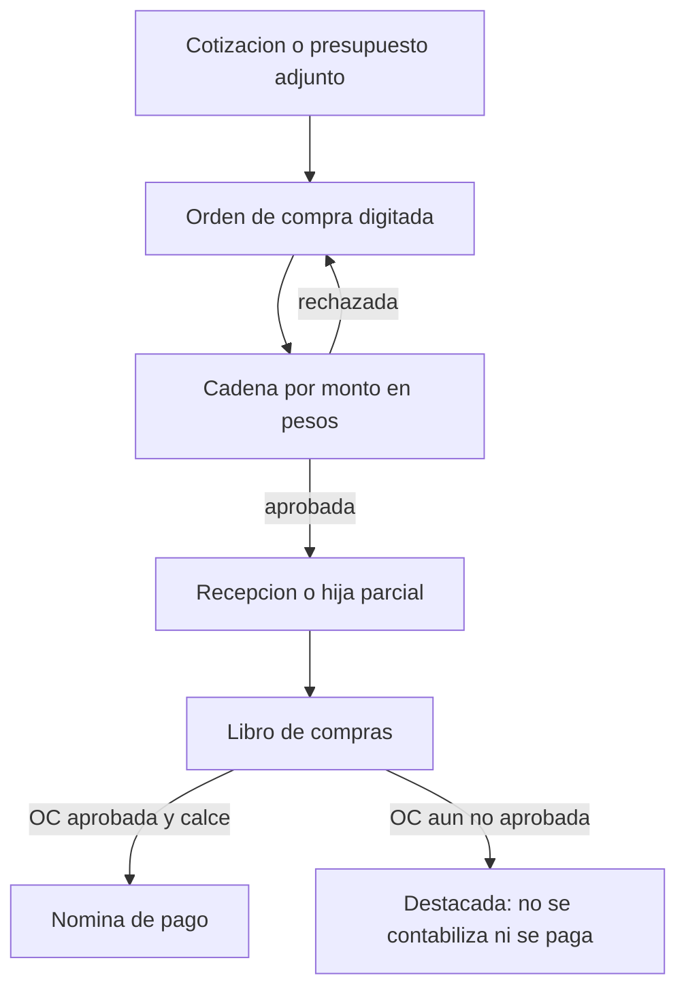
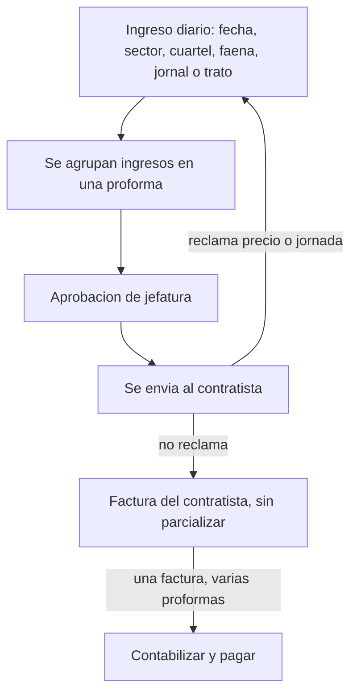
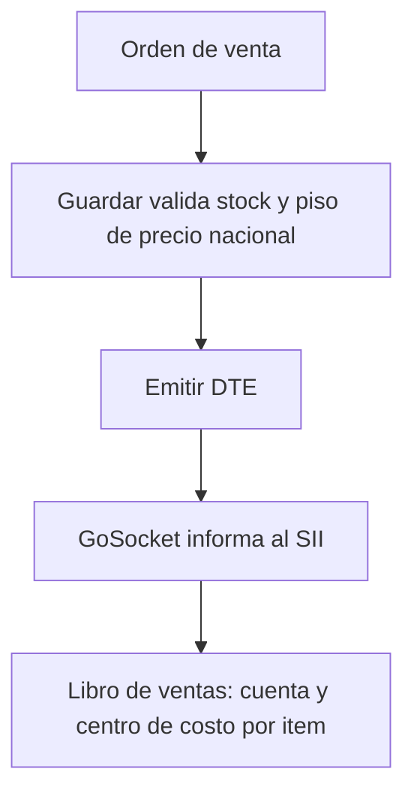
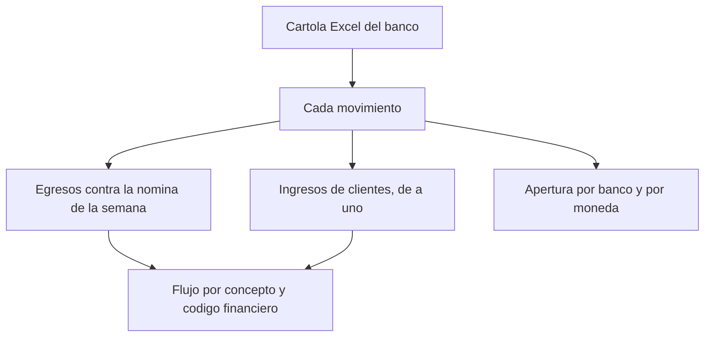

# Diagramas

Salen de lo que el cliente describio, con la frase mas nueva cuando hubo dos versiones. Las flechas del diagrama son la sintaxis del grafico.

## Compra de materiales y servicios

La orden grande es madre de control. Cada factura parcial abre las lineas y digita solo lo recepcionado. La hija no vuelve a la cadena. Si hay que subir o achicar la madre, la madre si vuelve a aprobacion.

Si el monto de la orden en dolares cambia de tramo, el tipo de cambio del dia la pasa a pesos y se compara en pesos.

## Contratistas (06/10)

Una proforma de 9600 no acepta una factura de 5600. Si el contratista reclama, se edita el ingreso de origen y la proforma vuelve a jefatura.

## Venta

Producto: solo articulos ya creados y bodega. Servicio: sin bodega. Exportacion: tipo de cambio del dia, libre respecto del precio de bodega. La nota de credito o debito de exportacion hereda el tipo de cambio de la factura de origen y nace precargada.

## Tesoreria

El saldo de apertura no se borra. El flujo suma bancos y se informa en pesos. La vista por banco muestra la moneda de esa cuenta sin convertirla ahi.

## Lo que no entra en el primer dibujo

El cliente dejo fuera de la primera puesta en marcha el banco en linea, la contabilidad electronica al SII y la carga historica de documentos (al final de la implementacion). Maquinaria y graficos de gerencia los pidieron y no tienen flujo cerrado.
