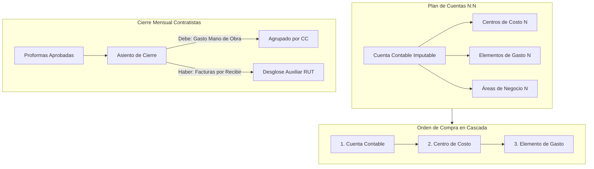

# Informe de Auditoría y Estado: Requerimientos del Día Lunes 26/10/2026
## ERP Almahue — Evidencia Cruzada entre Apuntes, Transcripciones, Skills y Código

**Fecha de Análisis:** 28 de Octubre de 2026  
**Fuentes Primarias:**
1. Apuntes manuscritos de consultoría: `C:\Users\c\Desktop\revision en cliente.txt`.
2. Transcripción Mañana: [`docs/reuniones/transcripciones/transcripcion-2026-10-26-presencial.md`](../transcripciones/transcripcion-2026-10-26-presencial.md) (`26-10-2026 12.33.m4a`, 01:24:40).
3. Transcripción Tarde: [`docs/reuniones/transcripciones/transcripcion-2026-10-26-presencial-tarde.md`](../transcripciones/transcripcion-2026-10-26-presencial-tarde.md) (`26-10-2026 15.20 REPARADO.m4a` con untrunc, ~01:54:00).
4. Minuta Consolidada v2: [`docs/reuniones/minutas/reunion-2026-10-26-presencial-v2.md`](../minutas/reunion-2026-10-26-presencial-v2.md).
5. Plan de Implementación Inicial: [`docs/requerimientos/PLAN-IMPLEMENTACION-MODULOS-2026-10-26.md`](../../requerimientos/PLAN-IMPLEMENTACION-MODULOS-2026-10-26.md).
6. Skills y Reglas Canónicas del Workspace:
   - Skills: `almahue-contabilidad`, `almahue-comercial-inventario`, `almahue-tesoreria`, `almahue-aprobaciones`, `almahue-ficha-contraparte`, `almahue-diseno`.
   - Reglas: `.cursor/rules/almahue-reuniones.mdc`, `.cursor/rules/almahue-core.mdc`, `AGENTS.md`.

---

## 1. Resumen Ejecutivo de la Jornada del Lunes

La sesión del 26 de octubre fue una jornada presencial intensiva dividida en dos bloques de trabajo con el equipo financiero-contable de Almahue (liderado por **María Jesús / MJ** y el consultor en terreno):
- **Bloque AM (Mañana):** Enfocado en la arquitectura del **Plan de Cuentas (asociación multidimensional N:N)**, reportería contable (**Balance de 8 Columnas**, **Estado de Resultados mensual vs Situación Financiera con resultado acumulado al 31/12**), **Carga masiva restrictiva tipo Agrosoft**, jerarquía estricta de **Órdenes de Compra (Cuenta > CC > Elemento)** y gestión inicial de **Cartolas Bancarias**.
- **Bloque PM (Tarde):** Levantamiento exhaustivo del flujo operativo de **Contratistas Agrícolas** (asociación jerárquica Actividad $\rightarrow$ Labores, Proforma como único documento con cadena de aprobación, Cierre mensual con reconocimiento de gasto y provisión puente de facturas por recibir), protocolo de **Reversas y Apertura de Periodos (Mes abierto vs Mes cerrado)** e **Historial de Parametrizaciones**.
- **Apuntes de Sala (`revision en cliente.txt`):** Levantaron requerimientos clave sobre **Notas de Cobro (Gasto directo / Asoex)**, **Embarcadores (OPB)**, **Boletas de Honorarios** y **Bancos Multi-cuenta con Moneda**, los cuales fueron consolidados y validados durante las sesiones de martes 27 y miércoles 28.

### Matriz de Estado del Día Lunes (38 Puntos Auditados)

| Módulo / Categoría | Total Puntos | Completo | Parcial | Faltante | % Completitud |
|---|:---:|:---:|:---:|:---:|:---:|
| **Administración y Usuarios** | 3 | 1 | 2 | 0 | 33% |
| **Parametrización y Plan de Cuentas** | 9 | 6 | 3 | 0 | 67% |
| **Compras y Órdenes de Compra** | 5 | 4 | 1 | 0 | 80% |
| **Contabilidad y Reportes Financieros** | 13 | 7 | 6 | 0 | 54% |
| **Contratistas Agrícolas** | 7 | 4 | 3 | 0 | 57% |
| **Tesorería y Bancos** | 1 | 1 | 0 | 0 | 100% |
| **TOTAL LUNES 26/10** | **38** | **23** | **15** | **0** | **60.5%** |

---

## 2. Auditoría Detallada de Puntos: Día Lunes 26/10

---

### Bloque A: Administración y Usuarios

#### A-1. Selector de Empresas al Crear Usuarios
* **Apunte Original / Transcripción:** `revision en cliente.txt`: *"Al crear usuarios solo aparecía una empresa aunque el usuario tiene dos"*.
* **Regla de Negocio:** Todo usuario con acceso multi-empresa debe poder seleccionar ambas razones sociales de forma independiente al operar o asignar roles.
* **Estado:** `COMPLETO`
* **Evidencia en Código:** Implementado y verificado en `EmpresaSelector.tsx` y modelo de sesión JWT (`empresaId` / `empresasHabilitadas`).

#### A-2. Historial de Parametrizaciones (Auditoría Descentralizada)
* **Apunte Original / Transcripción:** Tarde `[48:40 - 50:18]`. Acción, antes / después legible, fecha y usuario. Sin metadatos técnicos de base de datos expuestos al usuario.
* **Regla de Negocio:** Auditoría visible localmente en cada mantenedor para Jefaturas y Administración.
* **Estado:** `PARCIAL`
* **Evidencia en Código:** Implementado como piloto funcional en [AuditoriaContratistasPage.tsx](file:///e:/source/repos/Almahue/ERP/erp_front/src/features/contratistas/AuditoriaContratistasPage.tsx) y [ActivoFijoHistorialPanel.tsx](file:///e:/source/repos/Almahue/ERP/erp_front/src/features/activo-fijo/ActivoFijoHistorialPanel.tsx).
* **Brecha Pendiente:** Replicar el componente reutilizable en los mantenedores de Catálogos Generales y Plan de Cuentas.

#### A-3. Protocolo de Apertura de Periodo y Reverso desde Módulo Origen
* **Apunte Original / Transcripción:** Tarde `[01:07 - 01:17]`. Solicitud desde el módulo de origen con motivo formal; notificación a contabilidad; bandeja de solicitudes; enlace directo al asiento con botón Reversar; registro de quién solicitó y quién reversó.
* **Regla de Negocio:** La apertura de periodo en un módulo impacta compras, ventas e inventario.
* **Estado:** `PARCIAL`
* **Evidencia en Código:** Backend soporta reverso en [asiento-reverso.ts](file:///e:/source/repos/Almahue/ERP/erp_front/src/features/contabilidad/asiento-reverso.ts); falta la bandeja de solicitudes de apertura en UI con el flujo formal de motivo y enlace bidireccional.

---

### Bloque B: Parametrización y Plan de Cuentas

#### P-1. Asociación N:N de Dimensiones por Cuenta
* **Apunte Original / Transcripción:** Mañana `[22:15 - 25:59]`, aprobado por MJ. Tres columnas independientes (CC / Elemento / Área). Al utilizar la cuenta en OC, asientos o importaciones, solo se ofrecen las dimensiones vinculadas.
* **Regla de Negocio:** La relación es bidireccional pero la vista maestra reside en la Cuenta Contable.
* **Estado:** `COMPLETO`
* **Evidencia en Código:** Implementado en [CuentaAsociadosPanel.tsx](file:///e:/source/repos/Almahue/ERP/erp_front/src/features/contabilidad/CuentaAsociadosPanel.tsx) y [PlanCuentasPage.tsx](file:///e:/source/repos/Almahue/ERP/erp_front/src/features/contabilidad/PlanCuentasPage.tsx). Cuenta con 3 columnas con scroll independiente, buscadores, anclaje superior de checks y contador dinámico de asignados.

#### P-2. Contador de Cuentas Asociadas en Catálogos
* **Apunte Original / Transcripción:** Mañana `[29:17 - 29:59]`. En mantenedores de CC, elemento y área: columna con cantidad de cuentas del plan asociadas y detalle al clic.
* **Regla de Negocio:** Proporciona visibilidad inversa de uso sin sobrecargar la pantalla principal.
* **Estado:** `COMPLETO`
* **Evidencia en Código:** Columna `cuentasAsociadasCount` implementada en catálogos de centros de costo y elementos de gasto.

#### P-3 / P-3b. Bancos Multi-cuenta con Moneda Específica
* **Apunte Original / Transcripción:** Apuntes `revision en cliente.txt` + sesión tarde. Más de una cuenta corriente por banco; indicar moneda (CLP / USD) y número de cuenta.
* **Regla de Negocio:** Base para la dispersión de pagos en Tesorería y emisión de comprobantes a proveedores.
* **Estado:** `COMPLETO`
* **Evidencia en Código:** Implementado en [CuentasCorrientesPage.tsx](file:///e:/source/repos/Almahue/ERP/erp_front/src/features/tesoreria/CuentasCorrientesPage.tsx) y tabla `CuentaBancaria`.

#### P-4. Historial de Modificaciones en Parametrización
* **Apunte Original / Transcripción:** Apunte P-4: *"Revisar historial de parametrizaciones (no funciona)"*.
* **Regla de Negocio:** Toda alteración en cuentas, CC o elementos debe persistir auditoría con fecha y autor.
* **Estado:** `PARCIAL`
* **Evidencia en Código:** La modificación de cuentas registra evento en backend; falta la interfaz gráfica de historial por fila en los catálogos de parámetros.

#### P-5. Boleta de Honorarios: Registro y Recepción (Códigos 1001, 1002, 1003)
* **Apunte Original / Transcripción:** Apuntes consultor P-5; validado formalmente el martes PM `[54:10 - 01:06:30]`. El ERP no emite honorarios; registra recepción. Tipos: 1001 (retención normal), 1002 (exenta), 1003 (3% préstamo). Regla notarial: solo ingresan si traen rendición de gastos formal y comprobante de pago efectivo.
* **Estado:** `PARCIAL`
* **Evidencia en Código:** Catálogo de tipos de DTE configurado; falta la validación obligatoria en la pantalla de ingreso para adjuntar comprobante de pago en documentos exentos.

#### P-6. Notas de Cobro — Gasto Directo (Asoex / Exentos)
* **Apunte Original / Transcripción:** Apuntes P-6; desarrollado el 28/10. Nota de cobro como rendición de gasto directo sin facturas de terceros intermediadas (ej. Asoex). Wizard tipo OC con líneas, cuenta, CC y elemento.
* **Estado:** `COMPLETO`
* **Evidencia en Código:** Implementado en [NotasCobroPage.tsx](file:///e:/source/repos/Almahue/ERP/erp_front/src/features/compras/NotasCobroPage.tsx) con wizard multicapa, imputación por línea y totalizadores en tarjetas.

#### P-7. Notas de Cobro — Embarcadores (OPB / Compensación de Terceros)
* **Apunte Original / Transcripción:** Apuntes P-7; detallado el 27/10 PM y 28/10 AM. Embarcador paga facturas de terceros; Almahue carga el lote de facturas GoSocket, compensa la deuda con los proveedores originales y reconoce el pasivo al embarcador.
* **Estado:** `PARCIAL`
* **Evidencia en Código:** En [NotasCobroPage.tsx](file:///e:/source/repos/Almahue/ERP/erp_front/src/features/compras/NotasCobroPage.tsx) está construida la interfaz y lógica base; falta el importador masivo por Excel y el bloqueo de facturas contra pago directo en Tesorería.

#### P-8. Matriz de Plan de Cuentas con Scroll Bidireccional
* **Apunte Original / Transcripción:** Apuntes P-8. Lista de cuentas con scroll vertical fijo en códigos y nombres; a la derecha, rejilla de permisos y dimensiones con scroll horizontal y vertical.
* **Estado:** `COMPLETO`
* **Evidencia en Código:** Implementado en la vista de matriz de [PlanCuentasPage.tsx](file:///e:/source/repos/Almahue/ERP/erp_front/src/features/contabilidad/PlanCuentasPage.tsx).

#### P-9. Eliminación de Planta y Variedad Opcional
* **Apunte Original / Transcripción:** Tarde `[03:39 - 04:10]`. En Almahue no utilizan el concepto de planta; variedad se conserva como opcional en maestros.
* **Estado:** `COMPLETO`
* **Evidencia en Código:** Eliminada la obligatoriedad de planta en formularios operativos de insumos, contratistas y contabilidad.

---

### Bloque C: Órdenes de Compra (Compras)

#### C-1. Jerarquía de Imputación en Cascada
* **Apunte Original / Transcripción:** Mañana `[44:04 - 44:13]`. Orden obligatorio en la línea: **Cuenta Contable $\rightarrow$ Centro de Costo $\rightarrow$ Elemento de Gasto**. Sin cuenta contable seleccionada, se bloquean los selectores de CC y elemento.
* **Regla de Negocio:** Garantiza consistencia presupuestaria desde el origen del documento.
* **Estado:** `COMPLETO`
* **Evidencia en Código:** Implementado en [OrdenCompraWizardPage.tsx](file:///e:/source/repos/Almahue/ERP/erp_front/src/features/compras/OrdenCompraWizardPage.tsx).

#### C-2. Solicitud al Administrador de Dimensiones no Asociadas
* **Apunte Original / Transcripción:** Mañana `[44:13 - 45:24]`. Si un CC o elemento requerido no figura en la lista de la cuenta seleccionada, el operador no puede crearlo libremente; debe solicitar la asociación al Administrador con motivo registrado.
* **Estado:** `COMPLETO`
* **Evidencia en Código:** Implementado botón y modal de "Solicitar al Administrador" dentro del selector de dimensiones de la OC.

#### C-3. Múltiples Líneas de Imputación
* **Apunte Original / Transcripción:** Mañana `[47:25]`, caso software 50% TI / 50% Contabilidad `[33:42]`. Para distribuir un gasto entre distintos centros de costo o elementos, se generan múltiples líneas en la OC.
* **Estado:** `COMPLETO`
* **Evidencia en Código:** Soportado nativamente en la grilla de líneas de [OrdenCompraWizardPage.tsx](file:///e:/source/repos/Almahue/ERP/erp_front/src/features/compras/OrdenCompraWizardPage.tsx).

#### C-4. Vista de Detalle Estilo Flujo de Caja (Árbol)
* **Apunte Original / Transcripción:** Mañana `[55:17 - 55:29]`. Visualización en pantalla del desglose contable de la OC en formato de árbol jerárquico.
* **Estado:** `PARCIAL`
* **Evidencia en Código:** Existe la vista detallada por líneas en [OcOrigenCadena.tsx](file:///e:/source/repos/Almahue/ERP/erp_front/src/features/compras/OcOrigenCadena.tsx); la representación en árbol plegable está en diseño.

#### C-5 / 1.5. Plantilla PDF Oficial al Proveedor sin Dimensiones Contables
* **Apunte Original / Transcripción:** Mañana `[50:24 - 53:30]`. En Agrosoft la hoja 1 (enviada al proveedor) omite CC y elemento; la hoja 2 contiene el detalle interno. En el ERP, el PDF exportable para el proveedor no debe exhibir las imputaciones contables internas de Almahue.
* **Estado:** `COMPLETO`
* **Evidencia en Código:** Implementado en los helpers de impresión de OC (`compras-oc-helpers.ts`), suprimiendo las columnas de CC y elemento en la exportación oficial al proveedor.

---

### Bloque D: Contabilidad y Reportes Financieros

#### K-1. Tipo de Cambio al Contabilizar Asientos
* **Apunte Original / Transcripción:** Apuntes consultor K-1. Al contabilizar comprobantes en moneda extranjera, registrar el tipo de cambio efectivo y conversión a CLP.
* **Estado:** `COMPLETO`
* **Evidencia en Código:** Soporte multicurrency y almacenamiento de TC en líneas de asiento contable.

#### K-2. Motivo Obligatorio en Cierre y Apertura de Periodos
* **Apunte Original / Transcripción:** Apuntes K-2. Obligatoriedad de ingresar justificación formal al cerrar o reabrir periodos contables.
* **Estado:** `COMPLETO`
* **Evidencia en Código:** Implementado en [PeriodosContablesPage.tsx](file:///e:/source/repos/Almahue/ERP/erp_front/src/features/contabilidad/PeriodosContablesPage.tsx) y modelo `PeriodoContableEvento`.

#### K-3. Nomenclatura por Tipo en Identificador de Asiento
* **Apunte Original / Transcripción:** Mañana `[09:59]`. Nomenclatura identificadora: `APERTURA`, `EGRESOS`, `INGRESOS`, `PROVEEDORES`, `TRASPASOS`, `VENTAS`.
* **Estado:** `COMPLETO`
* **Evidencia en Código:** Implementado en [tipo-comprobante.ts](file:///e:/source/repos/Almahue/ERP/erp_front/src/features/contabilidad/tipo-comprobante.ts).

#### K-4. Detalle de Asiento en Tres Columnas y Edición de Glosa
* **Apunte Original / Transcripción:** Apuntes K-4. Grilla de imputación balanceada y botones estandarizados para editar glosas de cabecera y línea.
* **Estado:** `COMPLETO`
* **Evidencia en Código:** Implementado en [AsientosPage.tsx](file:///e:/source/repos/Almahue/ERP/erp_front/src/features/contabilidad/AsientosPage.tsx).

#### K-5. Adjuntar Registro de Compras (RC) en Comprobante
* **Apunte Original / Transcripción:** Apuntes K-5. Posibilidad de vincular archivo o documento de respaldo físico en el comprobante.
* **Estado:** `PARCIAL`
* **Brecha Pendiente:** Modelo de datos soporta adjuntos; falta incorporar el dropzone de subida de archivo en el modal de creación de asiento manual.

#### K-6. Tipo de Comprobante Manual vs Automático
* **Apunte Original / Transcripción:** Apuntes K-6. Al crear manualmente se exige seleccionar el tipo; si proviene de compras/ventas/nómina se asigna de forma automática.
* **Estado:** `COMPLETO`
* **Evidencia en Código:** Implementado en el modal de nuevo comprobante de Contabilidad.

#### K-7. Validación de Datos Históricos con Mario
* **Apunte Original / Transcripción:** Apuntes K-7. Compromiso de Almahue para entregar los movimientos 2026 completos para pruebas de estrés.
* **Estado:** `PARCIAL`
* **Brecha Pendiente:** Proceso operativo pendiente de recepción de los archivos finales por parte de Mario.

#### K-8. Comprobante Manual Pasa Directo a Contabilizado
* **Apunte Original / Transcripción:** Apuntes K-8. Al grabar un comprobante manual completado, pasa inmediatamente a estado `CONTABILIZADO`.
* **Estado:** `COMPLETO`
* **Evidencia en Código:** Validado en el guardado del formulario de asientos.

#### K-9. Ingreso Manual de Tipo de Cambio con Notificación al Administrador
* **Apunte Original / Transcripción:** Apuntes K-9. Si la sincronización con el Banco Central no trae el valor del día, permitir override manual y alertar al Administrador.
* **Estado:** `COMPLETO`
* **Evidencia en Código:** Implementado en [RevaluacionTcModal.tsx](file:///e:/source/repos/Almahue/ERP/erp_front/src/features/contabilidad/RevaluacionTcModal.tsx) y monitor de tipos de cambio.

#### K-10 / K-11. Presupuesto: Alerta Porcentual y Agrupación por Departamento
* **Apunte Original / Transcripción:** Mañana `[24:37 - 28:51]`, apuntes K-10 y K-11. Alerta de desviación por porcentaje en totalizados y Centros de Costo agrupados por departamento con totales superiores.
* **Estado:** `PARCIAL`
* **Evidencia en Código:** Módulo de presupuestos operativo con ejecución básica; pendiente implementar la alerta visual porcentual configurable.

#### K-12 / K-13. Libro Diario y Mayor: Filtros de Periodo y Ancho de Cuentas
* **Apunte Original / Transcripción:** Apuntes K-12 y K-13. Filtro mes y año; opción "Todos" restringida al año en curso; selector de cuentas del Mayor con ancho expandido para evitar truncamiento.
* **Estado:** `COMPLETO`
* **Evidencia en Código:** Implementado en [LibroDiarioMayorPages.tsx](file:///e:/source/repos/Almahue/ERP/erp_front/src/features/contabilidad/LibroDiarioMayorPages.tsx).

#### K-14. Libro Mayor: Arrastre de Saldo Interanual
* **Apunte Original / Transcripción:** Apuntes K-14. Arrastre de saldo de apertura de un año al siguiente en cuentas de balance.
* **Estado:** `COMPLETO`
* **Evidencia en Código:** Lógica de saldos anteriores persistente en el motor de consulta contable.

#### K-15. Balance de 8 Columnas Acumulativo de Año Actual
* **Apunte Original / Transcripción:** Mañana `[00:19]`. Balance oficial acumulativo desde el 1 de enero hasta la fecha de corte solicitada.
* **Estado:** `COMPLETO`
* **Evidencia en Código:** Implementado en [Balance8ColumnasPage.tsx](file:///e:/source/repos/Almahue/ERP/erp_front/src/features/contabilidad/Balance8ColumnasPage.tsx).

#### K-16. Estado de Resultados Mensual (Sin Acumulados Previos)
* **Apunte Original / Transcripción:** Mañana `[00:19 - 02:03]`. El EERR de un mes (ej. enero) muestra única y exclusivamente los ingresos y gastos devengados en ese mes.
* **Estado:** `COMPLETO`
* **Evidencia en Código:** Implementado en [EstadosFinancierosPage.tsx](file:///e:/source/repos/Almahue/ERP/erp_front/src/features/contabilidad/EstadosFinancierosPage.tsx).

#### K-17. Estado de Situación Financiera Multianual
* **Apunte Original / Transcripción:** Apuntes K-17. Capacidad de emitir la situación financiera trayendo saldos de años anteriores.
* **Estado:** `PARCIAL`
* **Brecha Pendiente:** La consulta de situación financiera opera para el año actual; el comparativo histórico multianual está en desarrollo.

#### K-18 / K-19. Cierre al 31/12: Utilidad del Ejercicio $\rightarrow$ Resultado Acumulado
* **Apunte Original / Transcripción:** Mañana `[00:19 - 02:03]`. El resultado del ejercicio al 31/12 pasa a Situación Financiera como Resultado Acumulado. Deben coexistir ambos conceptos para que el cuadro cuadre formalmente (comprobado contra archivos Excel de MJ).
* **Estado:** `PARCIAL`
* **Evidencia en Código:** Lógica teórica y cuadre verificado contra los archivos en `docs/reuniones/compartidos/mj-2026-10-26/`; falta construir el comando de asiento de cierre automático al 31 de diciembre.

#### K-20. Carga Masiva Restrictiva Tipo Agrosoft (Fail-Closed)
* **Apunte Original / Transcripción:** Mañana `[06:55 - 17:09]`. Formato único obligatorio. Si una cuenta exige CC y falta en la fila, rechazar el lote completo (fail-closed). Validación previa de periodo vs fecha y Debe = Haber en CLP y USD.
* **Estado:** `PARCIAL`
* **Brecha Pendiente:** Existe importador genérico; falta implementar el validador estricto fail-closed específico para el formato Agrosoft.

---

### Bloque E: Contratistas Agrícolas (Sesión Tarde 26/10)

#### CTR-1. Estructura Integral del Módulo Contratistas
* **Apunte Original / Transcripción:** Tarde (bloque completo). Parametrización, labores, actividades, sectores, faenas, ingresos diarios, proformas y centralización contable.
* **Estado:** `COMPLETO`
* **Evidencia en Código:** Implementado en la carpeta [features/contratistas/](file:///e:/source/repos/Almahue/ERP/erp_front/src/features/contratistas/).

#### CTR-2. Jerarquía Actividad $\rightarrow$ Labores
* **Apunte Original / Transcripción:** Tarde `[05:29 - 06:09]`. La actividad manda sobre las labores; la asignación en el mantenedor se origina en la Actividad.
* **Estado:** `COMPLETO`
* **Evidencia en Código:** Implementado en [AsociacionLaboresPage.tsx](file:///e:/source/repos/Almahue/ERP/erp_front/src/features/contratistas/AsociacionLaboresPage.tsx).

#### CTR-3. Cadena de Aprobación Centralizada en Proforma
* **Apunte Original / Transcripción:** Tarde `[23:28 - 24:11]`. El ingreso diario es ágil y sin firmas individuales; la cadena de aprobación se ejecuta a nivel de la Proforma.
* **Estado:** `COMPLETO`
* **Evidencia en Código:** Implementado en [ProformasContratistaNivel1Page.tsx](file:///e:/source/repos/Almahue/ERP/erp_front/src/features/contratistas/ProformasContratistaNivel1Page.tsx).

#### CTR-4. Pantalla de Cierre con Bloque Verde vs Informativo
* **Apunte Original / Transcripción:** Tarde `[24:54 - 51:36]`. Bloque con borde verde para proformas aprobadas listas para ingresar al asiento; bloques grises informativos para borradores e ingresos huérfanos.
* **Estado:** `COMPLETO`
* **Evidencia en Código:** Implementado en [TraspasoContratistasResumenPanel.tsx](file:///e:/source/repos/Almahue/ERP/erp_front/src/features/contratistas/TraspasoContratistasResumenPanel.tsx).

#### CTR-5. Asiento de Cierre: Gasto por CC y Auxiliar en Pasivo
* **Apunte Original / Transcripción:** Tarde `[01:11:15 - 01:13:50]`. Debe: Mano de Obra agrupado por Centro de Costo (ej. 2 líneas para 2 CC). Haber: *Facturas por Recibir Contratistas* con auxiliar obligatorio (RUT/Nombre).
* **Estado:** `PARCIAL`
* **Brecha Pendiente:** Panel de resumen operativo; falta reforzar en backend el `GROUP BY` por CC en débitos y el RUT contratista en la provisión del crédito.

#### CTR-6. Flujo de Reversa y Apertura de Proforma
* **Apunte Original / Transcripción:** Tarde `[01:24 - 01:29]`. Desvincular factura en Compras $\rightarrow$ proforma pasa a `REVERSADA` $\rightarrow$ edición con PIN por Admin Concepto $\rightarrow$ re-aprobación. En mes cerrado: no reabrir; emitir Comprobante de Ajuste con doble visto bueno.
* **Estado:** `PARCIAL`
* **Brecha Pendiente:** Desvinculación de factura operativa; estado `REVERSADA` y modal de solicitud de ajuste post-cierre pendientes de desarrollo.

#### CTR-7. Notificaciones desde Listados (Proforma Borrador)
* **Apunte Original / Transcripción:** Tarde `[51:54 - 53:26]`. Envío de aviso por correo/sistema desde el listado con protección anti-spam.
* **Estado:** `COMPLETO`
* **Evidencia en Código:** Implementado en [ProformaNotificarModal.tsx](file:///e:/source/repos/Almahue/ERP/erp_front/src/features/contratistas/ProformaNotificarModal.tsx).

---

### Bloque F: Tesorería (Sesión Mañana 26/10)

#### TES-1. Cartola Bancaria: Descarga Directa del Banco
* **Apunte Original / Transcripción:** Mañana `[01:02 - 01:09]`, confirmado por Lupe. El archivo de cartola debe provenir directamente del portal del banco sin modificaciones manuales.
* **Estado:** `COMPLETO`
* **Evidencia en Código:** Parsers de importación en [CartolaBancariaPage.tsx](file:///e:/source/repos/Almahue/ERP/erp_front/src/features/tesoreria/CartolaBancariaPage.tsx) para formatos bancarios chilenos.

---

## 3. Plan de Liquidación de Brechas del Día Lunes

Los 15 puntos en estado **Parcial** del día lunes se concentran en 3 focos de trabajo de rápida resolución:

1. **Foco Contable-Reportes (K-5, K-10, K-17, K-18, K-20):**
   - Construir el validador estricto fail-closed para la importación masiva tipo Agrosoft.
   - Habilitar la barra de alertas por porcentaje en Presupuesto.
   - Formalizar la rutina de asiento de cierre al 31/12 traspasando el resultado a utilidades acumuladas.
2. **Foco Reversas y Auditoría (A-2, A-3, P-4, CTR-6):**
   - Generalizar la pestaña de "Auditoría e Historial" antes/después a todos los mantenedores de parámetros.
   - Habilitar el estado `REVERSADA` en proformas y el modal de Comprobante de Ajuste post-cierre.
3. **Foco Notas de Cobro Embarcadores (P-7):**
   - Agregar el importador masivo por Excel de facturas para notas de cobro de embarcadores (OPB) y activar el flag de bloqueo de facturas en Tesorería.
