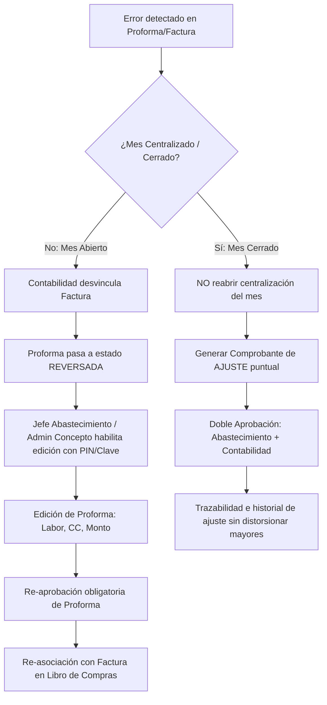

# Reunión Almahue — 27/10/2026 (Minuta Sesión AM / Mañana)

Minuta técnica y operativa correspondiente a la sesión de la mañana del 27 de octubre de 2026.

| Parámetro | Detalle |
|---|---|
| **Sesión** | **AM (Mañana / Mediodía)** |
| **Fecha y Hora** | 27/10/2026, ~12:11 – 13:30 (Duración: 01:18:10) |
| **Fuente Audio** | `C:\Users\c\Desktop\27-10-2026 12.11 (1).m4a` |
| **Audio WAV** | `docs/reuniones/medios/whisper-local/2026-10-27-reunion/audio.wav` (16kHz mono) |
| **Transcripción** | [`docs/reuniones/transcripciones/transcripcion-2026-10-27-reunion.md`](../transcripciones/transcripcion-2026-10-27-reunion.md) |
| **Participantes** | Equipo Contabilidad/Finanzas Almahue (María Jesús / Fran / Lupe / Mario), Devint (Carlos / Sergio). Actor clave del flujo: José Tomás (Jefe de Abastecimiento). |

---

## 1. Facturación Electrónica (DTE) y Guías de Despacho `[00:00 - 01:05]`

* **Validación contra esquema DTE:**  
  Los proveedores de facturación tradicionales validan el XML contra el esquema (schema XSD) antes de enviar al SII. Si el esquema es inválido, rechazan internamente de inmediato.  
  En cambio, GoSocket transmite el documento al SII sin bloqueo previo de esquema, provocando que sea el SII quien lo rechace. Esto genera un ciclo de reproceso y descarte más largo en caso de inconsistencias.
* **Emisión de Guías de Despacho `[00:50 - 01:02]`:**  
  Se acuerda revisar en las próximas semanas la emisión de guías de despacho directamente desde la plataforma del ERP, asegurando la inclusión y consistencia de los campos operativos requeridos por Almahue.

---

## 2. Plan de Cuentas y Experiencia de Usuario `[01:03 - 02:15]`

* **Revisión en Servidor de Pruebas:**  
  Se valida la carga y navegación en el nuevo servidor de pruebas.  
* **Diseño y Usabilidad:**  
  El equipo de Almahue valora positivamente la simplificación visual y operativa del plan de cuentas, confirmando que resuelve los requerimientos del checklist contable de forma más limpia e intuitiva.

---

## 3. Flujo Operativo y Segregación de Roles en Contratistas `[44:20 - 48:09]`

* **Rol de José Tomás (Jefe de Abastecimiento) `[47:10 - 47:53]`:**  
  - Administra los contratos con los contratistas agrícolas.  
  - Emite la **Proforma de Contratista** y es quien la **aprueba** a nivel de gestión/abastecimiento.  
  - No debe requerir un exceso de aprobaciones redundantes antes de contabilidad: el foco debe estar en la correcta imputación de labores, cuarteles y centros de costo.
* **Rol de Contabilidad (Fran / Lupe / Mario) `[47:53 - 48:15]`:**  
  - Recibe la **Factura de Compra** del contratista.  
  - Realiza el **calce/asociación** de la factura contra la proforma aprobada.  
  - Controles obligatorios de validación: coincidencia de monto neto/total y RUT del proveedor emisor.

---

## 4. Contabilización y Asiento de Cierre de Contratistas `[36:05, 56:11 - 57:40, 01:07:00 - 01:13:50]`

### 4.1 Mecánica Contable de Reconocimiento del Gasto
1. **Al centralizar el módulo de contratistas (Cierre Mensual):**  
   Se reconoce el gasto devengado del periodo independientemente de si la factura ya llegó o no:
   * **Debe:** *Gasto Mano de Obra Contratista* (clasificado por Centro de Costo / Cuartel / Labor).
   * **Haber:** *Facturas por Recibir Contratistas* (cuenta de pasivo / provisión transitoria).
2. **Al calzar la Factura en Libro de Compras `[36:05, 48:00 - 48:15]`:**  
   La factura salda la provisión y devenga la deuda exigible y el crédito fiscal:
   * **Debe:** *Facturas por Recibir Contratistas* (neto de la proforma).
   * **Debe:** *IVA Crédito Fiscal*.
   * **Haber:** *Proveedores por Pagar*.

### 4.2 Requerimientos de la Grilla del Asiento de Cierre `[01:11:15 - 01:13:50]`
* **Agrupación por Centro de Costo en cuentas de gasto `[01:11:29 - 01:12:07]`:**  
  Si existen 20 proformas en el mes y corresponden a 2 centros de costo distintos, el asiento debe consolidar exactamente **2 líneas de gasto** agrupadas por Centro de Costo.
* **Detalle del Auxiliar en Facturas por Recibir `[01:12:47 - 01:13:47]`:**  
  En la cuenta *Facturas por Recibir Contratistas*, es mandatorio registrar y mostrar el **Auxiliar (RUT / Razón Social del contratista)**. Esto permite a Contabilidad analizar la cuenta corriente de provisiones y saber con precisión qué facturas faltan por recibir o calzar.
* **Diseño visual:** Ajustar a 3 columnas balanceadas la visualización de imputación contable en pantalla.

---

## 5. Protocolo de Reversas y Ediciones (Mes Abierto vs Mes Cerrado) `[48:10 - 56:45, 58:00 - 01:06:40]`

### 5.1 Caso A: Dentro del Mes (Periodo Abierto / No Centralizado) `[48:10 - 54:40]`
1. Si la proforma ya fue asociada a factura en Contabilidad, **Contabilidad debe desvincular/reversar primero la factura**.
2. La proforma pasa al estado **`REVERSADA`** (explícitamente separado de `PENDIENTE` para alertar al equipo de que es un documento que ya había sido aprobado y tuvo reparos).
3. **Seguridad y permisos:** José Tomás no tiene perfil Administrador total ("Dios") para no alterar contabilidad. Para abrir la proforma en edición, se utiliza la figura de **Administrador de Concepto** con clave/PIN.
4. Una vez modificada la proforma, **debe reingresar a la cadena de aprobación** antes de poder volver a asociarse a factura.

### 5.2 Caso B: Periodo Cerrado y Centralizado (Mes Cerrado) `[58:00 - 01:06:40]`
* **Problema identificado en sistemas anteriores `[01:01:17 - 01:01:45]`:**  
  Desarmar la centralización mensual completa para cambiar una sola línea genera reversas masivas en los libros mayores, distorsionando la reportería y auditorías contables.
* **Solución acordada:**  
  - **No desarmar ni reabrir la centralización completa del mes**.
  - Crear un **Comprobante Contable de Ajuste** (tipo Ajuste / Traspaso) que corrige únicamente las líneas o centros de costo afectados.
  - **Doble Aprobación:** Requiere aprobación formal de la Jefatura de Abastecimiento/Contratistas y de la Jefatura de Contabilidad.
  - **Historial visual:** En la pantalla de centralización se mantiene un ícono de historial en la línea ajustada para auditar el antes y el después sin ensuciar el cierre contable original.

---

## 6. Metodología y Próximos Pasos `[01:14:00 - 01:15:40]`

* **Pruebas Integrales de Punta a Punta:**  
  Se acuerda programar jornadas de trabajo de **medio día completo presencial** una vez cerrado el desarrollo del módulo.  
* **Objetivo:** Ejecutar un ciclo operativo continuo con datos reales:  
  `Ingreso Diario` $\rightarrow$ `Proforma` $\rightarrow$ `Aprobación` $\rightarrow$ `Cierre Contratistas (Centralización)` $\rightarrow$ `Libro de Compras (Asociación Factura)` $\rightarrow$ `Pago / Tesorería` $\rightarrow$ `Validación en Balance y Mayores`.
