# Reunión Almahue — 27/10/2026 (Minuta Sesión PM / Tarde)

Minuta técnica y operativa correspondiente a la sesión de la tarde del 27 de octubre de 2026.

| Parámetro | Detalle |
|---|---|
| **Sesión** | **PM (Tarde)** |
| **Fecha y Hora** | 27/10/2026, ~15:24 – 17:15 (Duración: 01:47:50) |
| **Fuente Audio** | `C:\Users\c\Desktop\27-10-2026 15.24.m4a` |
| **Audio WAV** | `docs/reuniones/medios/whisper-local/2026-10-27-reunion-tarde/audio.wav` (16kHz mono) |
| **Transcripción** | [`docs/reuniones/transcripciones/transcripcion-2026-10-27-reunion-tarde.md`](../transcripciones/transcripcion-2026-10-27-reunion-tarde.md) |
| **Participantes** | Equipo Contabilidad/Finanzas Almahue (Fran / María Jesús / Lupe / Mario), Devint (Carlos / Sergio). |

---

## 1. Auditoría e Historial por Módulo `[00:00 - 02:40]`

* **Auditoría distribuida por módulo:**  
  En lugar de un módulo centralizado que mezcle todo, se acuerda implementar una pestaña o sección de **Auditoría e Historial** dentro de cada módulo operativo:
  - **Contratistas**
  - **Insumos y Bodega**
  - **Activos Fijos**
  - **Contabilidad**
* **Segregación de accesos:**  
  La auditoría solo debe ser visible por la Jefatura del Área respectiva y por Contabilidad/Administración, evitando visibilidad cruzada indebida.
* **Comportamiento en Insumos y Bodega `[00:10 - 00:47]`:**  
  Los ajustes post-cierre son casi inexistentes en Insumos porque el consumo se nutre automáticamente de las órdenes de consumo de packing/cuarteles y las recepciones se hacen respaldadas por guías de despacho físicas (lo efectivamente recibido). El único caso excepcional son devoluciones a proveedores.

---

## 2. Estructura y Flujo del Balance de 8 Columnas `[04:20 - 09:20]`

* **Cadena de reportería contable:**  
  $$\text{Libro Diario} \longrightarrow \text{Libro Mayor} \longrightarrow \text{Balance de 8 Columnas} \longrightarrow \text{Estado de Resultados y Situación Financiera}$$
* **Composición del Balance de 8 Columnas:**
  1. **Sumas:** Débitos (Debe) y Créditos (Haber).
  2. **Saldos:** Saldo Deudor y Saldo Acreedor.
     - *Regla general:* Cuentas de Activo y Gasto tienen saldo Deudor. Cuentas de Pasivo, Patrimonio e Ingresos tienen saldo Acreedor. Un saldo invertido indica error (salvo cuentas puente o provisiones transitorias).
  3. **Inventario (Situación Financiera):** Activo y Pasivo.
  4. **Resultados:** Pérdida y Ganancia.
* **Cuadre final:**  
  La diferencia entre Ganancias y Pérdidas determina el **Resultado del Ejercicio**, el cual debe cuadrar con la diferencia entre Inventario Activo e Inventario Pasivo.
* **Periodo de consulta:** Siempre acumulativo desde el 1 de enero hasta la fecha de corte solicitada.
* **Gate de centralizaciones:** Mientras módulos como Contratistas o Insumos no se centralicen contablemente, sus movimientos no ingresan al Balance oficial.

---

## 3. Notas de Cobro (Embarcadores / OPB y Asoex) `[15:17 - 23:00, 29:30 - 43:00, 45:30 - 54:00]`

Las Notas de Cobro no son documentos tributarios electrónicos del SII (no viajan por DTE/RCV), pero representan el 2% de los pasivos de compra (el 98% son facturas regulares):

```mermaid
flowchart TD
    subgraph Caso_OPB [Caso 1: Notas de Cobro Embarcadores - OPB]
        A1[Terceros emiten facturas a Almahue fletes/puertos] --> A2[Embarcador OPB paga las facturas por Almahue]
        A2 --> A3[OPB emite Nota de Cobro + Excel + comprobantes]
        A3 --> A4[Carga masiva en ERP con prevalidación]
        A4 --> A5[Asiento de compensación: Debe Proveedores originales / Haber Proveedor OPB]
        A5 --> A6[Facturas originales quedan BLOQUEADAS para pago]
    end

    subgraph Caso_ASOEX [Caso 2: Notas de Cobro Asoex - Gasto Directo]
        B1[Asoex emite Nota de Cobro cuota/comisión exportación] --> B2[Ingreso directo por módulo Proveedores]
        B2 --> B3[Asiento directo: Debe Gasto Comisión Comité / Haber Proveedor Asoex]
    end
```

### 3.1 Caso 1: Embarcadores (OPB / Freight Forwarders) — Facturas pagadas por cuenta de Almahue (98% de notas de cobro)
* **Operación:** El embarcador paga facturas de terceros a nombre de Almahue y luego cobra el reembolso consolidado mediante una Nota de Cobro, adjuntando PDF y planilla Excel con cientos de facturas asociadas.
* **Efecto contable obligatorio:**
  - Se deben **saldar/rebajar** las facturas pendientes con los proveedores originales.
  - Se debe **reconocer la deuda** exigible a favor del embarcador (OPB).
  - *Asiento contable:*  
    $$\text{Debe: Proveedores por Pagar (Proveedor original de cada factura)} \quad/\quad \text{Haber: Proveedores por Pagar (OPB - Nota de Cobro)}$$
* **Implementación acordada en el ERP:**
  - Crear un submódulo/pantalla de **Notas de Cobro** dentro del módulo de Compras/Proveedores.
  - Carga mediante planilla Excel con **prevalidación estricta**: el sistema verifica que todas las facturas existan en el ERP y que la suma de sus montos cuadre al 100% con la Nota de Cobro.
  - Al procesar, las facturas originales quedan bloqueadas contra pago directo en Tesorería.

### 3.2 Caso 2: Asoex (Asociación de Exportadores) — Gasto Directo (2% de notas de cobro)
* **Operación:** Cobro de cuotas o comisiones por exportación. Es un gasto directo exento de IVA (sin facturas de terceros asociadas).
* **Efecto contable:**
  - Se ingresa directo por el módulo de Proveedores como tipo de documento *Nota de Cobro*.
  - *Asiento contable:*  
    $$\text{Debe: Gasto Comisión Comité / Exportación} \quad/\quad \text{Haber: Proveedores por Pagar (Asoex)}$$

---

## 4. Activos Fijos y Órdenes de Compra (Requisito de Agustín) `[24:00 - 28:50]`

* **Instrucción de Agustín:**  
  En Agrosoft los activos fijos se creaban directo en contabilidad. Agustín instruyó formalmente que **toda adquisición de activo fijo debe nacer desde una Orden de Compra (OC)**.
* **Ajustes en Compras y Activos Fijos:**
  1. En el formulario de OC de Compras: agregar el tipo de compra **Activo Fijo** (adicional a Insumo y Servicio).
  2. Al recepcionar/aprobar la OC de activo fijo, habilitar la generación de la ficha en el maestro de Activos Fijos con la referencia a la OC.
  3. En la ficha de Activos Fijos: permitir seleccionar una OC existente o generar el activo asociado a su OC.
* **Reportería de Depreciación `[24:00 - 24:45]`:**  
  Almahue utiliza **depreciación lineal fija** (el valor decrece uniformemente mes a mes). El gráfico por activo individual resulta plano e innecesario; se acuerda reemplazarlo por un **gráfico consolidado general de depreciación mensual de toda la empresa**, permitiendo detectar cuándo empieza a depreciar un nuevo bien capitalizado.

---

## 5. Boletas de Honorarios: Códigos y Reglas de Notaría `[54:10 - 59:15, 01:01:30 - 01:06:30]`

* **Codificación de Tipos de Documento en Boletas de Honorarios:**
  - **1001:** Boleta de Honorarios Electrónica (con retención legal normal).
  - **1002:** Boleta de Honorarios Electrónica Exenta (sin retención).
  - **1003:** Boleta de Honorarios Electrónica con retención del 3% (préstamo solidario).
* **Tratamiento de Gastos Legales y Notariales (Dolores / Trinidad):**  
  - Frecuentemente se emiten al RUT de Almahue boletas exentas de notaría o timbres de montos menores (~$8.000) pagadas por abogados o gestores externos.
  - **Regla contable confirmada:** Solo se contabilizan en el ERP cuando existe una **Rendición de Gastos formal con comprobante de pago efectivo**. Si no están rendidas, **no se ingresan**, evitando duplicar gastos o acumular pasivos falsos en el sistema.

---

## 6. Tesorería y Carga de Cartolas Bancarias `[01:09:20 - 01:11:40]`

* **Visualización de Cuenta Corriente:**  
  En el mantenedor bancario y reportería de pagos, mostrar explícitamente el **Número de Cuenta Corriente** del banco para agilizar respaldos y envíos a proveedores.
* **Carga Recurrente de Cartolas (Evitar Duplicados):**  
  La cartola bancaria se sube de forma periódica (incluso a diario) y el archivo del banco repite días anteriores del periodo. El importador del ERP debe **discriminar movimientos preexistentes** y cargar únicamente las líneas nuevas sin duplicar registros contables.

---

## 7. Calendario Operativo y Salida a Producción `[01:12:00 - 01:14:00]`

* **Hito de Temporada Alta:**  
  La cosecha y embalaje arrancan con fuerza la **última semana de noviembre**.
* **Condición de Salida:**  
  El ERP debe entrar en operación en paralelo ("modo espejo") durante el primer mes de temporada alta.  
* **Requisito de datos (Compromiso Almahue):**  
  Para ejecutar pruebas con volumen real, Contabilidad (Mario) debe suministrar la data contable completa de movimientos del año 2026.
